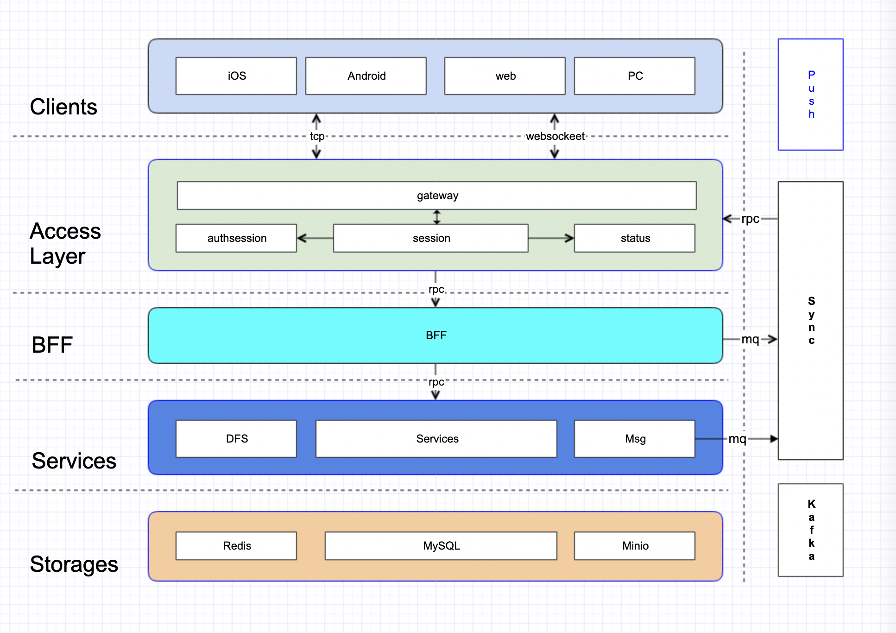

# Teamgram - Unofficial open source [mtproto](https://core.telegram.org/mtproto) server written in golang
> open source mtproto server implemented in golang with compatible telegram client.

## Introduce
Open source [mtproto](https://core.telegram.org/mtproto) server implementation written in golang, support private deployment.

## Features
- MTProto 2.0
  - Abridged
  - Intermediate
  - Padded intermediate
  - Full
- API Layer: 186
- private chat
- basic group
- contacts
- web

## Architecture


## Installing Teamgram 
`Teamgram` relies on high-performance components: 

- **mysql5.7**
- [redis](https://redis.io/)
- [etcd](https://etcd.io/)
- [kafka](https://kafka.apache.org/quickstart)
- [minio](https://docs.min.io/docs/minio-quickstart-guide.html#GNU/Linux)
- [ffmpeg](https://www.johnvansickle.com/ffmpeg/)

Privatization deployment Before `Teamgram`, please make sure that the above five components have been installed. If your server does not have the above components, you must first install Missing components. 

- [Centos9 Stream Build and Install](docs/install-centos-9.md) [@A Feel]
- [CentOS7 teamgram-server环境搭建](docs/install-centos-7.md) [@saeipi]

If you have the above components, it is recommended to use them directly. If not, it is recommended to use `docker-compose-env.yaml`.


### Source code deployment
#### Install [Go environment](https://go.dev/doc/install). Make sure Go version is at least 1.17.


#### Get source code　

```
git clone https://github.com/teamgram/teamgram-server.git
cd teamgram-server
```

#### Init data
- init database

	```
	1. create database teamgram
	2. init teamgram database
		mysql -uroot teamgram < pwm/sql/1_teamgram.sql
		mysql -uroot teamgram < pwm/sql/migrate-20220321.sql
		mysql -uroot teamgram < pwm/sql/migrate-20220326.sql
		mysql -uroot teamgram < pwm/sql/migrate-20220328.sql
		mysql -uroot teamgram < pwm/sql/migrate-20220401.sql
		mysql -uroot teamgram < pwm/sql/migrate-20220412.sql
		mysql -uroot teamgram < pwm/sql/migrate-20220419.sql
		mysql -uroot teamgram < pwm/sql/migrate-20220423.sql
		mysql -uroot teamgram < pwm/sql/migrate-20220504.sql
		mysql -uroot teamgram < pwm/sql/migrate-20220721.sql
		mysql -uroot teamgram < pwm/sql/migrate-20220826.sql
		mysql -uroot teamgram < pwm/sql/migrate-20220919.sql
		mysql -uroot teamgram < pwm/sql/migrate-20221008.sql
		mysql -uroot teamgram < pwm/sql/migrate-20221011.sql
		mysql -uroot teamgram < pwm/sql/migrate-20221016.sql
		mysql -uroot teamgram < pwm/sql/migrate-20221023.sql
		mysql -uroot teamgram < pwm/sql/migrate-20221101.sql
		mysql -uroot teamgram < pwm/sql/migrate-20221127.sql
		mysql -uroot teamgram < pwm/sql/migrate-20230707.sql
		mysql -uroot teamgram < pwm/sql/migrate-20240107.sql
		mysql -uroot teamgram < pwm/sql/migrate-20240108.sql
		mysql -uroot teamgram < pwm/sql/migrate-20240111.sql
		mysql -uroot teamgram < pwm/sql/migrate-20240112.sql
		mysql -uroot teamgram < pwm/sql/migrate-20240113.sql
		mysql -uroot teamgram < pwm/sql/migrate-20240114.sql
		mysql -uroot teamgram < pwm/sql/migrate-20240420.sql
		mysql -uroot teamgram < pwm/sql/migrate-20240620.sql
		mysql -uroot teamgram < pwm/sql/z_init.sql
	```

- init minio buckets
	- bucket names
	  - `documents`
	  - `encryptedfiles`
	  - `photos`
	  - `videos`
	- Access `http://ip:xxxxx` and create


#### Build
	
```
make
```

#### Run

```
cd pwm/bin
./runall2.sh
```

#### Import native stickers

The layer-186 sticker catalog can be populated from a PWM raw dataset containing
`version.txt`, `json_data/`, `tgs/`, and `preview/`. Validate the entire source
and calculate its deterministic checksum without connecting to MySQL, DFS,
MinIO, media, or idgen:

```bash
go run ./app/tool/stickerimport -source /path/to/data/stickers -dry-run
```

For a native import, copy `app/tool/stickerimport/stickerimport.example.yaml` to
a private runtime location and provide these environment variables (the go-zero
config loader expands `${NAME}` values):

```bash
export PWM_STICKER_DATA=/path/to/data/stickers
export PWM_STICKERIMPORT_MYSQL_DSN='user:password@tcp(127.0.0.1:3306)/pwm?charset=utf8mb4&parseTime=true'
export PWM_ETCD_HOST=127.0.0.1:2379
go run ./app/tool/stickerimport -source "$PWM_STICKER_DATA" -config /private/path/stickerimport.yaml -resume -verify -workers 8
```

Use `-set-id SOURCE_ID` to select one set or `-limit N` to select the first N
sets after full-dataset validation. Reruns retain source-to-native mappings;
`-verify` rechecks persisted media and DFS ranges. The source root and every
referenced file must be canonical and contained below the root; symlink escapes
are rejected. Apply `pwm/sql-input/migrate-20260810-layer186-stickers-reactions.sql`
before a non-dry-run import and run DFS, media, idgen, MySQL, etcd, and MinIO.

### Docker deployment
#### Install [Docker](https://docs.docker.com/get-docker/)

#### Install [Docker Compose](https://docs.docker.com/compose/install/)

#### Get source code

```
git clone https://github.com/teamgram/teamgram-server.git
cd teamgram-server
```

#### Run

```  
# run dependency
docker-compose -f ./docker-compose-env.yaml up -d

# run docker-compose
docker-compose up -d
```

## Redis Admin Proxy

For administrative access to Redis, this project includes a secure Redis proxy service that provides password-protected access to the Redis instance.

### Features
- **Password Authentication**: Requires admin authentication before allowing Redis operations  
- **External Access**: Safely exposes Redis to external admin tools
- **Connection Limiting**: Configurable maximum concurrent connections
- **Full Protocol Support**: Compatible with all Redis clients and tools

### Quick Start
```bash
# Start Redis admin proxy
./scripts/redis-proxy.sh start

# Test connection
redis-cli -h localhost -p 6380 -a admin_redis_2025!

# Check status  
./scripts/redis-proxy.sh status

# View logs
./scripts/redis-proxy.sh logs -f
```

### Configuration
The proxy runs on port `6380` by default with password `admin_redis_2025!`. You can customize these settings in `docker-compose-env.yaml`:

```yaml
redis-admin-proxy:
  environment:
    REDIS_ADMIN_PASSWORD: "your_secure_password"
    REDIS_PROXY_PORT: 6380
    REDIS_MAX_CONNECTIONS: 100
```

### Admin Tools Connection Examples
- **redis-cli**: `redis-cli -h your-server -p 6380 -a admin_redis_2025!`
- **Redis Desktop Manager**: Host: `your-server`, Port: `6380`, Auth: `admin_redis_2025!`  
- **RedisInsight**: Standalone connection with Host: `your-server`, Port: `6380`, Password: `admin_redis_2025!`

📚 **Full documentation**: [docs/redis-admin-proxy.md](docs/redis-admin-proxy.md)

## Compatible clients
**Important**: default signIn verify code is **12345**

[Android client for Teamgram](clients/teamgram-android.md)

[iOS client for Teamgram](clients/teamgram-ios.md)

[tdesktop for Teamgram](clients/teamgram-tdesktop.md)

## Feedback
Please report bugs, concerns, suggestions by issues, or join telegram group **[Teamgram](https://t.me/+TjD5LZJ5XLRlCYLF)** to discuss problems around source code.

## Notes
If need enterprise edition:

- sticker/theme/wallpaper/reactions/2fa/sms/push(apns/web/fcm)/secretchat/scheduled/...
- channel/megagroup
- audiocall/videocall/groupcall
- bots

please PM the **[author](https://t.me/benqi)**

## Give a Star! ⭐

If you like or are using this project to learn or start your solution, please give it a star. Thanks!
